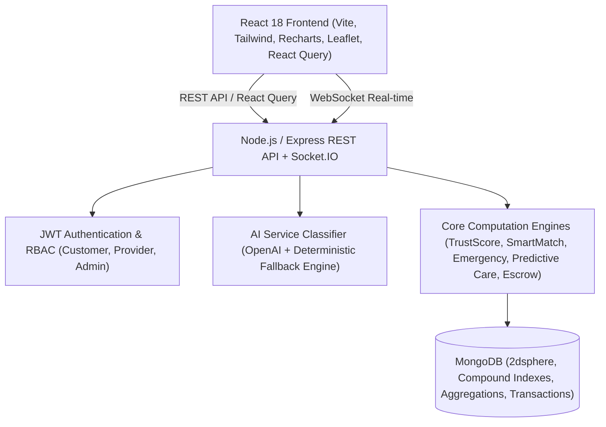
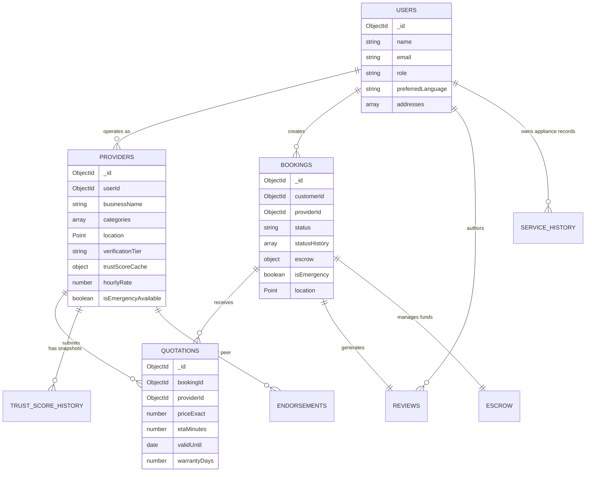

# SkillBridge — Local Service Marketplace Platform

> **Trust is a computed, explainable asset — not a star average.**  
> **Matching is reasoned, not ranked by ads or price.**  
> **Providers are treated as a community with a growth path, not gig-labor inventory.**

---

## 1. What Makes SkillBridge Different?

Most local-service apps (Urban Company, TaskRabbit clones) are simply a directory listing with a booking form and an unweighted 5-star average. **SkillBridge** was engineered with three core theses:

| Feature Dimension | Generic Marketplace Clones | SkillBridge Platform |
| :--- | :--- | :--- |
| **Trust Evaluation** | Unweighted, gaming-prone 5-star average | **7-factor computed TrustScore** with exponential penalty decay & historical trend snapshots |
| **Provider Ranking** | Sponsored ads, bidder paywalls, or raw price sorting | **Explainable SmartMatch ranking** with "Why Recommended" checklist & "Why NOT" score drag inspection |
| **Emergency Call-outs** | Surprise surge pricing on final invoices | **Transparent upfront emergency lock** (+20% late night, +₹150 dispatch fee) & auto-escalating radar net |
| **Payment Protection** | One-sided payment (customer pays, provider hopes) | **Fair-Split Dispute Escrow** (funds held until verification with 48h auto-release and arbitration) |
| **Peer Social Layer** | None (anonymous gig workers) | **Trust Circles**: Hyperlocal peer endorsements & neighborhood favorites feeding verification tiers |
| **Appliance History** | Static receipt archive | **AI Predictive Care**: Interval analysis predicting upcoming maintenance needs |
| **Accessibility & AI** | Basic keyword search or breaks without API key | **Dual-Path Issue Classifier**: OpenAI LLM + deterministic rule-based fallback + Web Speech voice input |

---

## 2. Mathematical Algorithms & Formulas

### 2.1 TrustScore Formula & Weights
The `calculateTrustScore(providerId)` function evaluates 7 weighted verifiable factors and subtracts exponentially decaying penalty points:

$$\text{TrustScore} = \sum (\text{Weight}_i \times \text{Factor}_i) - \text{ReportPenaltyDecayed}$$

```
score = 
    0.25 * normalizedRating (0-100) +
    0.20 * completionRate (0-100) +
    0.15 * (100 - cancellationRate) +
    0.15 * responseTimeScore (0-100) +
    0.10 * verificationBonus (0-100) +
    0.10 * repeatCustomerRate (0-100) +
    0.05 * accountAgeScore (0-100)
  - reportPenalty (exponential decay: initial * e^(-0.0077 * daysElapsed))
```

#### Factor Scoring Matrix:
- **Normalized Rating ($25\%$)**: $(\text{rating} / 5) \times 100$
- **Job Completion ($20\%$)**: $(\text{completedJobs} / \text{totalDispatchedJobs}) \times 100$
- **Low Cancellation ($15\%$)**: $\max(0, 100 - \text{cancellationRate})$
- **Response Speed ($15\%$)**: $\le 10\text{m} \rightarrow 100$, $\le 20\text{m} \rightarrow 90$, $\le 30\text{m} \rightarrow 80$, $\le 60\text{m} \rightarrow 65$, $>60\text{m} \rightarrow 45$
- **Verification Tier Bonus ($10\%$)**:
  - `Locally Endorsed`: $100\text{ pts}$ (3+ verified peer endorsements)
  - `Community Verified`: $85\text{ pts}$ (10+ completed jobs, zero upheld disputes)
  - `Document Verified`: $60\text{ pts}$ (Admin checked ID & licenses)
  - `Unverified`: $20\text{ pts}$ (Baseline)
- **Repeat Customer Loyalty ($10\%$)**: $(\text{repeatClients} / \text{totalUniqueClients}) \times 100$
- **Account Age Standing ($5\%$)**: $\min(100, (\text{daysActive} / 180) \times 100)$
- **Exponential Penalty Decay**: Upheld community reports subtract $15\text{ pts}$ initially. Every 90 days, the penalty halves ($\lambda = 0.007704$), providing a fair path to rehabilitate standing.

---

### 2.2 SmartMatch Multi-Criteria Ranking Formula

$$\text{MatchScore} = 0.30 \cdot \text{TrustScore} + 0.25 \cdot \text{Proximity} + 0.20 \cdot \text{Availability} + 0.15 \cdot \text{PriceFit} + 0.10 \cdot \text{PastTrackRecord}$$

- **Proximity Score ($25\%$)**: Inverse distance using Haversine calculation: $\max(0, (1 - (\text{distKm} / \text{maxRadius})) \times 100)$
- **Price Band Fit ($15\%$)**: Closeness to customer's stated target budget ceiling.
- **Explainable Reasoning**: Top matches include positive badges (e.g. *Hyperlocal 1.8km away*, *Rapid 12m response*), while lower-ranked providers expose expandable **Score Drag Factors** (e.g. *14km further away*, *Hourly rate exceeds target budget ceiling*).

---

## 3. Architecture & Tech Stack



- **Frontend**: React 18, Vite, Tailwind CSS, Lucide Icons, Leaflet / React-Leaflet, Recharts, `@tanstack/react-query`, Web Speech API.
- **Backend**: Node.js, Express.js, MongoDB / Mongoose ODM (with automated zero-config `mongodb-memory-server` runner + Atlas support), Socket.IO, Zod validation, JWT, Bcrypt, Rate Limiting.
- **Testing**: Jest + Supertest test suites (`trustScore.test.js`, `smartMatch.test.js`, `emergency.test.js`, `escrow.test.js`).

---

## 4. Database Schema & Collections



---

## 5. Quick Start & Local Execution

### 1. Installation
```bash
# From repository root
npm run install:all
```

### 2. Running Backend and Frontend Concurrently
```bash
npm start
```
- **Frontend App**: `http://localhost:5173`
- **Backend API**: `http://localhost:5000/api`
- **Health Check**: `http://localhost:5000/api/health`

### 3. Preloaded Demo Accounts (1-Click Switcher Available in UI)
| Role | Email | Password | Locality / Details |
| :--- | :--- | :--- | :--- |
| **Customer** | `customer1@skillbridge.in` | `password123` | Indiranagar, Bangalore |
| **Provider** | `provider1@skillbridge.in` | `password123` | Suresh Quick Electricals (Locally Endorsed) |
| **Admin** | `admin@skillbridge.in` | `admin123` | Platform Moderator & Dispute Arbitrator |

### 4. Running Automated Test Suites
```bash
npm run test:backend
```
Verifies TrustScore weighting, Haversine geospatial proximity, emergency transparent surcharges, and the AI fallback classifier.
